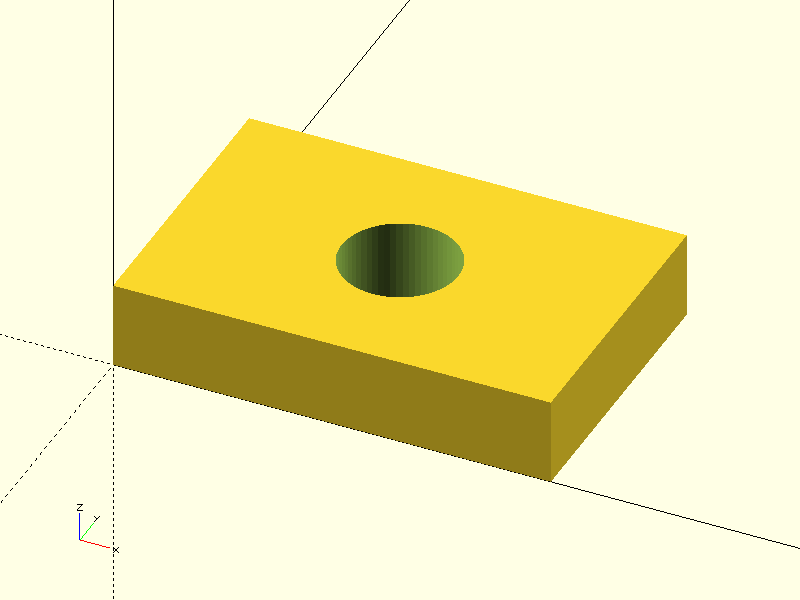

```{=html}
<section id="stl-explorer" class="stl-explorer" aria-labelledby="stl-heading">
  <h3 id="stl-heading">Turn the model around</h3>
  <div class="stl-tools">
    <label for="stl-model">Example</label>
    <select id="stl-model" data-model aria-label="Choose a 3D example"></select>
    <button type="button" data-fullscreen hidden>Full screen</button>
  </div>
  <p class="stl-status" data-status role="status" aria-live="polite">Interactive view loading. The image and downloads also work without the viewer.</p>
  <div class="stl-grid">
    <div>
      <div class="stl-stage">
        
        <canvas tabindex="0" aria-label="3D model. Drag to rotate, scroll to zoom, or use the view buttons. Arrow keys rotate when this canvas is focused."></canvas>
      </div>
      <p class="stl-size" data-size>30 × 20 × 6 mm (X × Y × Z)</p>
      <p class="stl-help">Drag to rotate; scroll or pinch to zoom. Arrow keys rotate when the model has focus. Axes at the origin: X red, Y green, Z blue.</p>
      <div class="stl-tools">
        <button type="button" data-view="angled">Angled view</button>
        <button type="button" data-view="top">Top</button>
        <button type="button" data-view="side">Side</button>
        <button type="button" data-zoom="0.8" aria-label="Zoom in">Zoom +</button>
        <button type="button" data-zoom="1.25" aria-label="Zoom out">Zoom −</button>
        <button type="button" data-reset>Reset view</button>
      </div>
    </div>
    <div class="stl-code">
      <pre aria-label="OpenSCAD source for the selected example"><code data-code>difference() {
  cube([30, 20, 6]);
  translate([15, 10, -1])
    cylinder(h=8, d=8, $fn=64);
}</code></pre>
      <p data-note>The first shape stays; the cylinder cuts a hole through it. Change the code in OpenSCAD to make your own version.</p>
      <div class="stl-tools">
        <a class="stl-download" data-scad-link download href="../archive/3d-printing/difference.scad">Download .scad</a>
        <a class="stl-download" data-stl-link download href="../archive/3d-printing/difference.stl">Download .stl</a>
      </div>
    </div>
  </div>
  <div class="stl-tools">
    <label for="stl-wire"><input id="stl-wire" type="checkbox" data-wire> Show triangles</label>
    <label for="stl-height">Show height</label>
    <input id="stl-height" type="range" min="0" max="100" step="1" value="100" data-height>
    <output for="stl-height" data-height-value>100%</output>
  </div>
  <p class="stl-help">The height slider is a cutaway view. Inspect actual print layers and toolpaths in Bambu Studio. This viewer displays exported models; it does not run OpenSCAD code.</p>
  <div class="stl-tools">
    <label for="stl-upload">Open your own STL</label>
    <input id="stl-upload" type="file" accept=".stl" data-upload>
  </div>
  <p class="stl-help">Files stay in your browser. Maximum 20 MB and 300,000 triangles. STL has no unit label; coordinates here are read as millimetres.</p>
  <noscript><p>JavaScript is off. Use the rendered examples and downloadable files below, or open the STLs in Bambu Studio.</p></noscript>
</section>
<script type="module">
import('../assets/3d-printing/viewer.js').catch(() => {
  document.querySelector('#stl-explorer [data-status]').textContent = 'Interactive view unavailable. Use the rendered examples and downloads below.';
});
</script>
```
