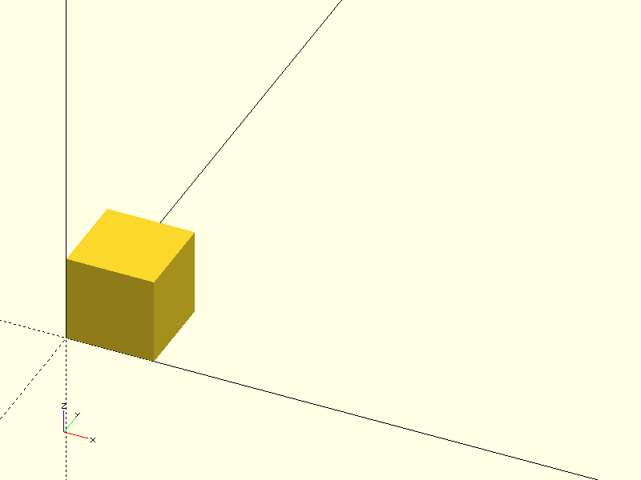

```{=html}
<section id="stl-explorer" class="stl-explorer" aria-labelledby="stl-heading">
  <h3 id="stl-heading">Build a PCB stand, one step at a time</h3>
  <div class="stl-tools" data-navigation hidden>
    <button type="button" data-mode="walkthrough" aria-pressed="true">Build the stand</button>
    <button type="button" data-mode="explore" aria-pressed="false">Other models</button>
    <button type="button" data-fullscreen hidden>Full screen</button>
  </div>
  <div class="stl-step-nav stl-tools" data-walkthrough hidden>
    <button type="button" data-back disabled>← Back</button>
    <span data-progress>Step 1 of 10</span>
    <button type="button" data-next>Next →</button>
    <button type="button" data-restart>Start over</button>
  </div>
  <div class="stl-tools" data-explore hidden>
    <label for="stl-model">Example</label>
    <select id="stl-model" data-model aria-label="Choose a 3D example"></select>
  </div>
  <h4 class="stl-status" data-status role="status" aria-live="polite">Step 1: Start with a cube</h4>
  <p class="stl-step-note" data-note>Make one solid: a cube, 20 mm on each side. The three numbers are X, Y and Z. Everything we add later will build on this starting point.</p>
  <div class="stl-grid">
    <div>
      <div class="stl-stage">
        
        <canvas tabindex="0" aria-label="3D model with labeled axes: X red, Y green, Z blue. Drag to rotate, scroll to zoom, or use the view buttons. Arrow keys rotate when this canvas is focused."></canvas>
        <span class="stl-axis-label stl-axis-x" data-axis="X" aria-hidden="true">X</span>
        <span class="stl-axis-label stl-axis-y" data-axis="Y" aria-hidden="true">Y</span>
        <span class="stl-axis-label stl-axis-z" data-axis="Z" aria-hidden="true">Z</span>
      </div>
      <p class="stl-size" data-size>20 × 20 × 20 mm (X × Y × Z)</p>
      <div class="stl-tools" data-camera-tools>
        <button type="button" data-view="angled">Angled view</button>
        <button type="button" data-view="top">Top</button>
        <button type="button" data-view="side">Side</button>
        <button type="button" data-zoom="0.8" aria-label="Zoom in">Zoom +</button>
        <button type="button" data-zoom="1.25" aria-label="Zoom out">Zoom −</button>
        <button type="button" data-reset>Reset view</button>
      </div>
    </div>
    <div class="stl-code">
      <p class="stl-code-key"><span data-code-key>Complete OpenSCAD code</span> <span class="stl-change-key" data-change-key hidden>New or changed</span></p>
      <pre tabindex="0" aria-label="Complete OpenSCAD source. Soft shading and a margin marker indicate new or changed lines."><code data-code>// Units: mm. PCB stand worked example.
cube([20, 20, 20]);</code></pre>
      <div class="stl-tools">
        <a class="stl-download" data-scad-link download target="_blank" rel="noopener noreferrer" href="../archive/3d-printing/walkthrough/01-cube.scad">Download this .scad</a>
        <a class="stl-download" data-stl-link download target="_blank" rel="noopener noreferrer" href="../archive/3d-printing/walkthrough/01-cube.stl">Download this .stl</a>
      </div>
    </div>
  </div>
  <details class="stl-extra">
    <summary>Viewer tools and help</summary>
    <div class="stl-tools">
      <label for="stl-wire"><input id="stl-wire" type="checkbox" data-wire> Show triangles</label>
      <label for="stl-height">Show height</label>
      <input id="stl-height" type="range" min="0" max="100" step="1" value="100" data-height>
      <output for="stl-height" data-height-value>100%</output>
    </div>
    <p class="stl-help">Drag to rotate; scroll or pinch to zoom. Arrow keys rotate when the model has focus. Axes: X red, Y green, Z blue. The same camera position is kept between steps so changes in size and position stay visible.</p>
    <p class="stl-help">The height slider is a cutaway view, not a slicer preview. Each step shows an exported model and its complete code. Edit the downloaded .scad in OpenSCAD to try your own changes.</p>
    <div data-upload-tools hidden>
      <div class="stl-tools">
        <label for="stl-upload">Open your own STL</label>
        <input id="stl-upload" type="file" accept=".stl" data-upload>
      </div>
      <p class="stl-help">Files stay in your browser. Maximum 20 MB and 300,000 triangles. STL has no unit label; coordinates here are read as millimetres.</p>
    </div>
  </details>
  <p class="stl-help" data-render-help hidden>The rotating view is unavailable. Next and Back still show each step's rendered image and code.</p>
  <noscript><p>JavaScript is off. <a target="_blank" rel="noopener noreferrer" href="../archive/3d-printing/worked-example.zip">Download the ten numbered steps</a> and open them in OpenSCAD to follow the worked example.</p></noscript>
</section>
<script type="module">
import('../assets/3d-printing/viewer.js').catch(() => {
  document.querySelector('#stl-explorer [data-status]').textContent = 'Interactive view unavailable. Download the numbered steps below to follow along in OpenSCAD.';
});
</script>
```
