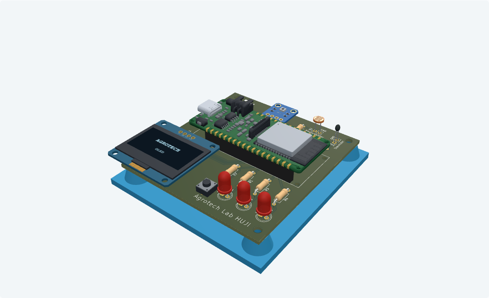

```{=html}
<section id="pcb-assembly" class="pcb-assembly" aria-labelledby="pcb-assembly-title">
  <h3 id="pcb-assembly-title">Look around the assembled PCB</h3>
  <p class="pcb-caption" data-status role="status">Loading the assembly. The image and downloads also work without the rotating view.</p>
  <div class="pcb-stage">
    
    <canvas tabindex="0" aria-label="PCB assembly. Drag or use arrow keys to rotate, and scroll to zoom."></canvas>
  </div>
  <div class="pcb-tools">
    <button type="button" data-view="angled">Angled view</button><button type="button" data-view="top">Top</button><button type="button" data-view="bottom">Underneath</button>
    <button type="button" data-zoom="0.8" aria-label="Zoom in">Zoom +</button><button type="button" data-zoom="1.25" aria-label="Zoom out">Zoom −</button>
    <button type="button" data-reset>Reset view</button><button type="button" data-fullscreen hidden>Full screen</button>
  </div>
  <div class="pcb-tools"><label><input type="checkbox" data-module checked> Show FireBeetle</label><label><input type="checkbox" data-stand checked> Show open stand</label></div>
  <p class="pcb-caption">Look for the OLED screen, SHT31 module, black thermistor bead, round photoresistor and pushbutton. Hide the FireBeetle to see the board beneath it. The parts use the PCB's actual connection positions; component shapes, module sizes, installed heights and colours are illustrative. The OLED lettering is a display example. Use the real lab parts to check fit, pin order and resistor values.</p>
  <noscript><p>JavaScript is off. Use the assembly image above or download the model below.</p></noscript>
</section>
<script type="module">
import('../assets/pcb-viewer/viewer.js').catch(()=>{
  document.querySelector('#pcb-assembly [data-status]').textContent='Rotating view unavailable. Use the assembly image and downloads below.';
});
</script>
```
