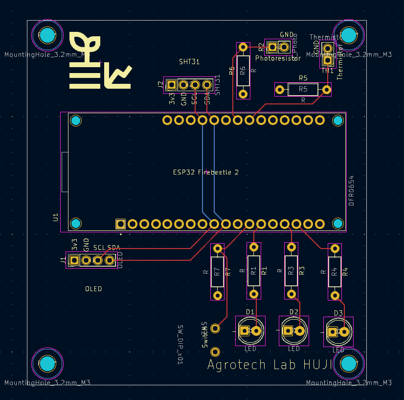

## Goal

Assemble and test your **custom ESP32 sensor board**.  
This assignment focuses on **hardware assembly**, **soldering**, and **verifying that all components on the PCB work correctly**.

You are encouraged to be creative (see Bonus section), but the minimum requirement is that **all onboard components function properly**.

## Hardware

You received a custom PCB that includes:

- ESP32 header (you bring your ESP32)
- I2C OLED (4-pin)
- SHT31 temperature & humidity sensor (I2C)
- 3× LEDs (each connected to a different GPIO via resistor)
- 1× momentary push-button (GPIO input)
- thermistor with voltage divider
- photoresistor (LDR) with voltage divider
- all required resistors, headers, and connectors (through-hole)
- PCB schematics (`.pdf`) and PCB layout (`.png`)

> This is your first time soldering a complete board.  
> Work slowly, inspect each joint, and **test as you go**. Poor soldering is the #1 cause of errors.

## Schematic

<embed src="../archive/images/Schematic.pdf" type="application/pdf" width="100%" height="800px" />

## PCB Layout

{width="600"}

## What your project must do

### **Assemble the PCB**
- Solder **all components**: headers, resistors, sensors, LEDs, button, connectors.
- Ensure correct resistor placement for the thermistor and photoresistor voltage dividers.
- Plug in the ESP32 and OLED once the board is fully assembled.

### **Demonstrate that every element works**
Write Arduino/ESP32 code that shows:

- **OLED** displays text correctly  
- **SHT31** returns live temperature & humidity readings  
- **Thermistor** analog value changes when heated/cooled  
- **Photoresistor** analog value changes with light/dark  
- **LEDs** turn ON/OFF individually via GPIO  
- **Button** press is detected correctly (debouncing optional)

You may display values on the OLED or print them to Serial Monitor, or both.

## Bonus ideas (optional)

These are not required, but highly encouraged:

- creative OLED interface (icons, animations, menus)
- use the button to switch display modes  
- implement a simple data logger (e.g., min/max temperature or light level)
- combine sensors into useful indicators  
  - e.g., “room too dark,” “bright sunlight,” “hot/cold,” etc.
- small interactive demo using LEDs and button  
  - reaction game  
  - bar-graph of brightness  
  - fade LED based on light level
- **Be creative**

---

## What to submit

1. **Short video (30–90 seconds)**  
   Demonstrating:
   - working OLED  
   - SHT31 reading  
   - thermistor response  
   - photoresistor response  
   - LEDs turning on/off  
   - button press detection  

2. **Your Arduino/PlatformIO code** (`.ino` or full project folder)

---

## Tips for successful assembly

- Solder **from lowest components to highest** (resistors → ICs → headers).
- Check polarity for the **LEDs** and **SHT31 board**.
- Keep the soldering iron tip **clean and tinned**.
- If something doesn’t work, inspect solder joints first.

