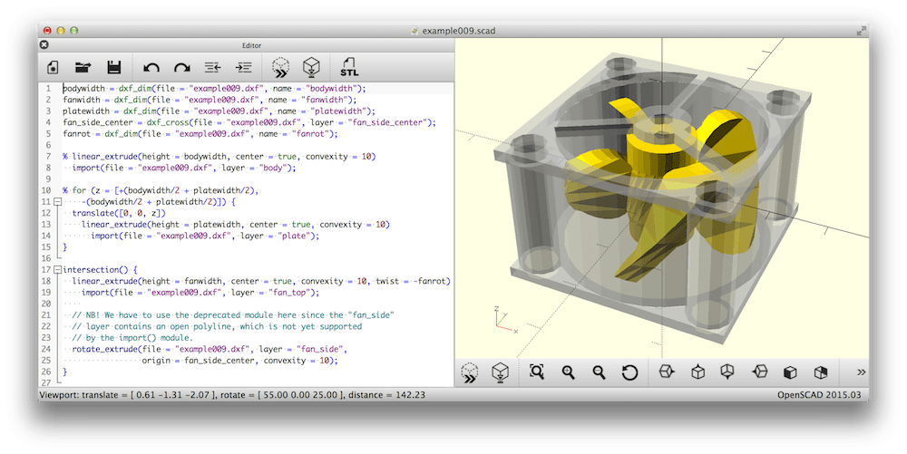
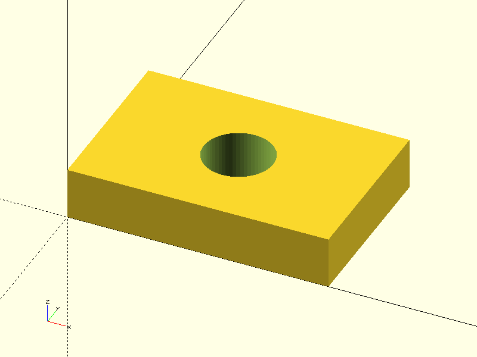
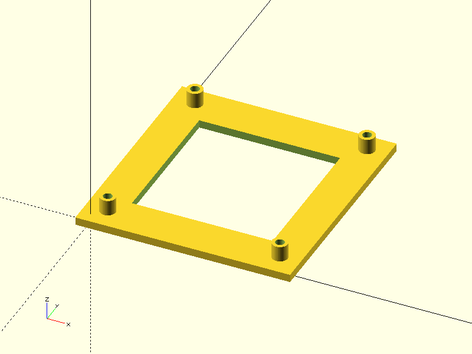
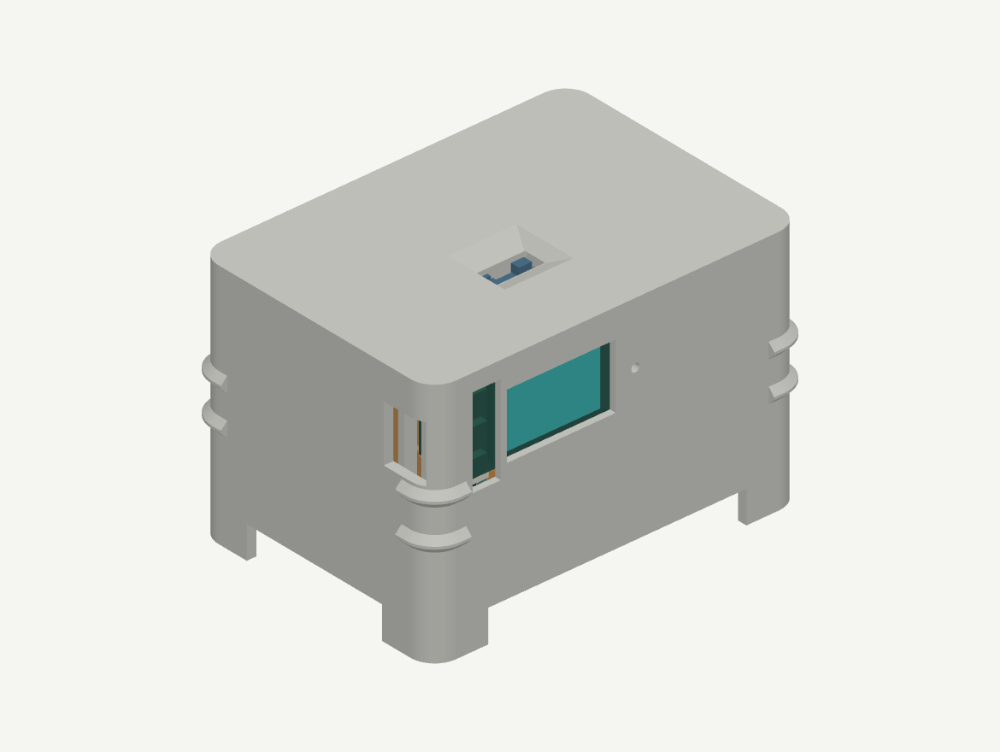
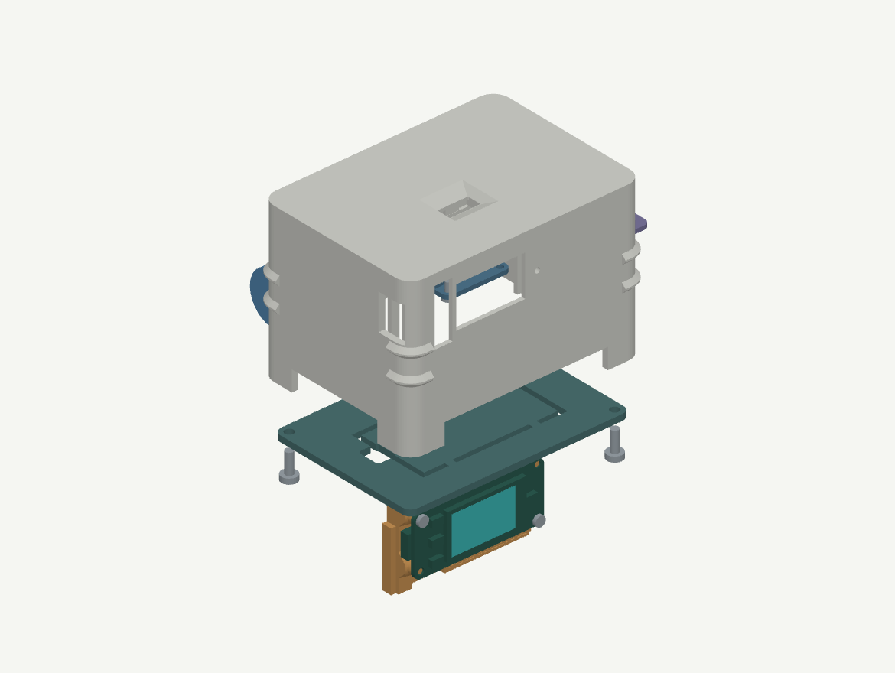

# 3D printing: from code to a real part {.unnumbered}

Today we will make a small part in **OpenSCAD**, prepare it in **Bambu Studio**, and connect that workflow to the PCB we are soldering in class. You do not need to become a CAD expert. The aim is to understand what the shapes and dimensions mean, so you can inspect and improve a design—even when an LLM writes the code.

## Our lab printer

We use a **Bambu Lab H2C with AMS**. The printer melts a plastic filament and lays it down in thin paths, building the object one layer at a time. This process is often called FDM or FFF printing.

The **AMS (Automatic Material System)** feeds and switches filament. The H2C's **Vortek system** changes hotends automatically. These do different jobs: switching the spool is different from exchanging the heated nozzle assembly. We will start with **one material and one colour**, using the installed nozzle and the matching printer profile. This lesson uses the 3D-printing functions. [Bambu Lab's H2C overview](https://blog.bambulab.com/bambu-lab-h2c-where-multi-material-vortek-system-meets-engineering-precision/).

## Install these two programs

| Program | What we use it for | Download |
|---|---|---|
| **OpenSCAD** | Describe dimensions and shapes with code, then export a model. | [Official OpenSCAD downloads](https://openscad.org/downloads.html) |
| **Bambu Studio** | Turn the model into layers and printer movements; preview the job and send it to the lab printer. | [Official Bambu Studio download](https://bambulab.com/en/download/studio), or [official releases](https://github.com/bambulab/BambuStudio/releases) |

Install the version for your operating system. OpenSCAD is free and available for Windows, macOS and Linux. In Bambu Studio's setup, add the **H2C** profile and select the nozzle diameter actually fitted to the printer. If H2C is missing, update Bambu Studio from the official download. The instructor will show you how the lab connects to the printer; you can model and slice before connecting.

**Bambu Studio** is the desktop slicer. **Bambu Handy** is the phone app; install Studio for this exercise. See [Bambu Studio's official project](https://github.com/bambulab/BambuStudio) for supported platforms and features.

## The files along the way

```{=html}
<div class="printing-workflow" role="group" aria-label="Printing workflow">
  <span><strong>Design</strong>OpenSCAD · .scad</span><span class="flow-arrow" aria-hidden="true">→</span>
  <span><strong>Export shape</strong>Triangle mesh · .stl</span><span class="flow-arrow" aria-hidden="true">→</span>
  <span><strong>Slice &amp; preview</strong>Bambu Studio · .3mf project</span><span class="flow-arrow" aria-hidden="true">→</span>
  <span><strong>Print</strong>Printer-specific job</span>
</div>
```

- **`.scad`** is the editable OpenSCAD source. Keep it: changing a number here is much easier than repairing a mesh later.
- **`.stl`** describes the surface as triangles. It does not contain your parameters, filament choice, or printing settings, and does not specify units. In this lesson, one coordinate unit means **one millimetre**. Confirm the dimensions when importing it.
- **`.3mf`** can store more than a shape. A saved Bambu Studio project keeps models and slicing settings together. OpenSCAD can also export geometry as 3MF, but that does not give it a Bambu printer profile.
- The **sliced print job** contains instructions for a particular machine and setup. An STL alone is not a ready-to-run print job. Re-slice a downloaded model using the lab's actual printer, nozzle, plate and material settings.

## OpenSCAD: write a shape, then look at it

{fig-alt="Official OpenSCAD screenshot with a text editor on the left and a preview of a mechanical part on the right."}

Screenshot source: [OpenSCAD's website](https://openscad.org/). The model images further down were rendered from this lesson's own files.

### Find Preview, Render and Export

This close-up uses the toolbar from the same screenshot. The numbered boxes identify the three buttons you need; your version may arrange them differently.

```{=html}
<figure class="openscad-toolbar-guide">
  <svg viewBox="280 20 135 80" role="img" aria-labelledby="openscad-toolbar-title">
    <title id="openscad-toolbar-title">OpenSCAD toolbar close-up: 1 is Preview, 2 is Render, 3 is Export as STL.</title>
    <image href="../archive/figures/3d-printing/openscad-interface.png" x="0" y="0" width="1000" height="495"/>
    <g fill="none" stroke="#bd6500" stroke-width="1.3">
      <rect x="295" y="56" width="28" height="34" rx="2"/>
      <rect x="329" y="56" width="28" height="34" rx="2"/>
      <rect x="370" y="56" width="28" height="34" rx="2"/>
    </g>
    <g fill="#175973"><circle cx="309" cy="39" r="10"/><circle cx="343" cy="39" r="10"/><circle cx="384" cy="39" r="10"/></g>
    <g fill="white" font-family="sans-serif" font-size="12" font-weight="bold" text-anchor="middle"><text x="309" y="43">1</text><text x="343" y="43">2</text><text x="384" y="43">3</text></g>
  </svg>
  <figcaption>Toolbar close-up from the older official screenshot. The menu commands below are the reliable way to find these actions.</figcaption>
</figure>
```

1. **Preview — F5:** the quick view while editing. Menu: **Design → Preview**.
2. **Render — F6:** calculate the final shape. Wait for it to finish and check the console for errors. Menu: **Design → Render**.
3. **Export as STL:** save the rendered model for the slicer. Menu: **File → Export → Export as STL**.

On a laptop, the function keys may need `Fn`. See the [OpenSCAD shortcut reference](https://github.com/openscad/openscad/wiki/Keyboard-Shortcuts).

### Try the workflow

1. Open OpenSCAD and create a new file.
2. Type `cube([30, 20, 6]);` and save it as `first-part.scad`.
3. Use **Design → Preview (F5)** to see a 30 × 20 × 6 mm block. On a laptop, you may need `Fn` with the function key.
4. Change `6` to `10` and preview again. You changed its height, not its width or depth.
5. Drag in the view to turn the model around and scroll to zoom.
6. When the design is ready, use **Design → Render (F6)**. Check the console for errors, then choose **File → Export → Export as STL**.

Preview is for quick editing; Render calculates the final geometry for export. Save both the `.scad` and `.stl` files. [OpenSCAD's export instructions](https://files.openscad.org/documentation/manual/STL_Export.html).

### A few rules that make the code readable

`[X, Y, Z]` means sideways, front-to-back, and height. A default `cube([30,20,6])` starts at the origin `[0,0,0]`; `center=true` puts its centre at the origin instead. A cylinder points along Z unless you rotate it.

A shape statement ends in `;`. Braces `{ ... }` group shapes. A transformation goes **before** the shape it changes, without a semicolon between them. `//` starts a comment. Dimensions and positions can be named variables, such as `wall = 2;`, instead of repeated numbers.

`$fn=64` asks for 64 segments around a circle. It makes round shapes look smoother; it does not change the printer's layer height. Start with moderate values so previews and STLs stay manageable. The [OpenSCAD cheat sheet](https://openscad.org/cheatsheet/) is a useful reference while reading code.

## Worked example: build the PCB stand {#worked-example}

We will build **one part, one change at a time**. Start with a cube, resize and move it, cut out the middle, add mounting posts, and finally cut the screw holes. The finished shape is the stand for our class PCB.

Press **Next** to make the next change, or **Back** to compare it with the previous step. The code uses OpenSCAD-style syntax colours; soft shading and a margin marker show which lines are new or changed. Each step is a complete OpenSCAD file that you can download and run. Try predicting the next shape before pressing the button.

Use **Full screen** when projecting. The camera stays in the same place as you advance, so resizing or moving the part is easy to see. You can still rotate the model, use Top view, or reset the view.



[Download all ten steps: OpenSCAD source + STLs](../archive/3d-printing/worked-example.zip)

Steps 1–9 build the finished shape. Step 10 makes the same shape using a `for` loop to replace repeated code. The intermediate models are teaching stages; use the finished stand and the screw-fit test for printing. The [PCB measurements below](#a-useful-print-for-our-soldering-pcb) explain where the mounting positions come from.

After the walkthrough, choose **Other models** to explore rotation, extrusion, the PCB assembly, or your own STL.

### The operations we use

| Operation | In plain language | What to notice |
|---|---|---|
| `cube()`, `cylinder()`, `sphere()` | Make a basic solid. | Dimensions, diameter versus radius, and where its origin sits. |
| `translate([x,y,z])` | Move a shape. | Its dimensions stay the same. |
| `rotate([x,y,z])` | Turn a shape by angles in degrees. | Rotation happens around the origin. The order of moving and turning matters. |
| `union()` | Join shapes. | Give the parts a small overlap so they form one solid. |
| `difference()` | Remove shapes from the first one. | The first child stays; all later children cut it. |
| `intersection()` | Keep only the overlap. | Everything outside the shared space disappears. |
| `linear_extrude(height=...)` | Give a flat 2D outline height. | Use `square()` or `circle()` inside it, not a 3D `cube()`. |

For transformations, read from the shape outward: in `translate(...) rotate(...) cube(...)`, make the cube, rotate it, then move it. See the official manual sections on [transformations](https://files.openscad.org/documentation/manual/Transformations.html), [combining solids](https://files.openscad.org/documentation/manual/CSG_Modelling.html), and [extrusion](https://files.openscad.org/documentation/manual/2D_to_3D_Extrusion.html).

### A hole is a shape that you subtract

```scad
difference() {
  cube([30, 20, 6]);
  translate([15, 10, -1])
    cylinder(h=8, d=8, $fn=64);
}
```

The block is 6 mm high. The cutting cylinder goes from Z = −1 to Z = 7, so it passes through both faces. A cutter that stops inside the block leaves a pocket; one outside the block does nothing. Try changing the hole diameter from `8` to `12`.

{width=520 fig-alt="OpenSCAD render showing a cylindrical through-hole cut out of a rectangular block."}

[Download this source](../archive/3d-printing/difference.scad) · [Download this STL](../archive/3d-printing/difference.stl)

### You can also start with a flat outline

```scad
linear_extrude(height=6)
  difference() {
    square([30, 20]);
    translate([15, 10])
      circle(d=8, $fn=64);
  }
```

This makes the same kind of part by cutting a circle from a 2D square first, then giving the result height. `rotate_extrude()` is another option for revolving a 2D profile around an axis, for example to make a round knob. Learn the simpler `linear_extrude()` workflow first.

[Download the extrusion example](../archive/3d-printing/extrude.scad) · [All examples, STLs and source files](../archive/3d-printing/class-examples.zip)

## A useful print for our soldering PCB

We will solder the [class PCB](soldering-and-wires.qmd#class-pcb), then try a **small open stand**. Four raised posts support the board at its mounting holes, leaving room underneath for trimmed component leads. The centre is open so the underside remains accessible.

These dimensions come from the supplied KiCad board, not an estimate from a photograph:

| Feature | Dimension |
|---|---|
| Board outline | **73.406 × 78.740 mm** |
| Board thickness in the design | **1.6 mm** |
| Four mounting holes | **3.2 mm diameter**, for M3 hardware |
| Hole columns, measured from the left edge | X = **4.318** and **69.596 mm** |
| Hole rows, measured from the bottom edge | Y = **4.572** and **75.438 mm** |

The holes are **not equally inset from all edges**. Copying “four holes 4 mm from each corner” would give the wrong locations. In our model, the origin is the bottom-left board corner when viewed from the component side, with X right and Y up.

{width=620 fig-alt="OpenSCAD render of a rectangular open frame with four raised mounting posts and through-holes."}

[View stand + PCB together](#stl-explorer){data-open-model="assembly"} · [Editable stand source](../archive/3d-printing/pcb-stand.scad) · [Printable stand STL](../archive/3d-printing/pcb-stand.stl)

The stand has a **3 mm base**, **6 mm posts above the base**, and **3.4 mm nominal screw holes**. Each post widens from an **8 mm top** to a **12 mm foot**, spreading the load into the frame. This leaves **2.3 mm of plastic around the hole at the top**, compared with 1.3 mm in the earlier version. Its overall size is **81.406 × 86.740 × 9 mm**. These are design choices you can change in the `.scad` file. A `for` loop repeats the same post at each coordinate in the `holes` list.

The green board in the viewer reproduces the outline, thickness and all **72 drilled holes**. It leaves out copper, components, connectors and solder joints. Use it to check the hole pattern; use the real populated PCB to check clearance and access. [See the assembled PCB in 3D](soldering-and-wires.qmd#pcb-in-3d) · [Board reference STL](../archive/3d-printing/pcb-reference.stl) · [Measured geometry data](../archive/hardware/soldering-board-1/board-dimensions.json).

::: {.callout-tip}
## Print a small fit test first
Print the [M3 screw-fit test](../archive/3d-printing/screw-fit.stl). Starting at its notched end, the holes are **3.2, 3.4 and 3.6 mm** in the design. Try your actual M3 screw in each one. Printed holes can come out smaller than drawn, so adjust `screw_d` in the stand after this test.

Use suitable M3 through-bolts and nuts, preferably nylon around the PCB. These are clearance holes, not printed screw threads; tighten gently rather than driving a screw into the plastic. Choose screw length after measuring the stand, board and fastening hardware together. Check that fasteners and posts clear the solder joints and traces. This is a prototype, not a physically tested fit.
:::

**Solder first, mount later.** Use a heat-resistant soldering surface. Let the board cool, trim the leads and inspect the joints before fitting the stand. A PLA stand is not a soldering fixture.

The editable KiCad project, schematic, original board image, custom libraries and manufacturing exports are now in the course repository. [Download the PCB project](../archive/hardware/soldering-board-1/soldering-board-project.zip) · [Read the schematic](../archive/hardware/soldering-board-1/Schematic.pdf).

## From STL to a print in Bambu Studio

1. **Open Bambu Studio and select the printer.** Use H2C and the actual installed nozzle diameter. Select the build plate and filament profile that match the lab setup. Begin with a single PLA colour if that is the material the instructor has loaded.
2. **Import the STL**, by dragging it onto the plate or using **File → Import**. Start with `screw-fit.stl`, then `pcb-stand.stl` after checking fit. Keep the PCB reference out of the print job.
3. **Check the dimensions.** The stand should be about 81.4 × 86.7 × 9 mm at 100% scale. If it is unexpectedly tiny or huge, resolve the units instead of guessing a scale factor. Scaling the whole stand also moves the mounting holes.
4. **Choose the orientation.** Put the stand's broad, flat base on the bed, with the posts pointing up. This design is intended to print in that orientation without supports. Inspect the preview to confirm that every new region has something below it.
5. **Start with a suitable preset.** With a 0.4 mm nozzle and ordinary PLA, a 0.20 mm layer-height preset is a reasonable first trial. Use the printer/material preset for temperatures. For this stand, try three walls and roughly 15–20% infill, then inspect the result. These are starting points, not a saved lab profile.
6. **Click Slice plate, then inspect Preview.** Move the layer slider from bottom to top. Look for the open window, four posts, clear screw holes, unsupported starts, and unexpected gaps. Read the estimated time and material use. Confirm any support or prime-tower material before printing.
7. **Save the project as `.3mf`.** This keeps your setup for the next iteration. Check the physical plate is clear, confirm the material-to-AMS-slot mapping, and have the instructor check the first job before using **Print plate** or the lab's offline transfer method.
8. **Watch the first layer and let the part cool.** Keep hands away from the hot nozzle, bed and moving mechanism. Remove the cooled part as demonstrated, try the screw-fit test, and measure before printing more copies.

An AMS slot containing the right colour can still contain the wrong **material**. Match the material as well. More colours and hotend changes can add time and material use, even with automatic switching. Keep the first exercise simple. [Bambu Studio documentation and project links](https://github.com/bambulab/BambuStudio).

## What to change when a print is disappointing

| What you want to improve | What to think about |
|---|---|
| A smoother curved surface | More curve segments in OpenSCAD, and possibly smaller layers in the slicer. They address different kinds of visible steps. |
| A stronger bracket | Orientation and wall thickness matter. Layer-to-layer bonding can be the weak direction; more infill alone does not fix everything. |
| A screw that will not fit | Print a fit test and change that hole diameter in the source. Keep the mounting-hole positions fixed. |
| An overhang that sags | Reorient the part, change the design, or add suitable supports. Supports take time and may leave marks when removed. |
| A first layer that does not stick | Check plate cleanliness, plate/material profile and the first layer with the instructor. |
| A part that fails near heat | Check material suitability. PLA is convenient for first indoor prototypes but can soften near heat; a printed part's temperature and load limits need checking. |

Keep ventilation running as directed in the lab. Ask before trying a new filament type, changing hotends, or altering printer maintenance settings.

## Working with an LLM on a model

Give the LLM as many **measured dimensions** as you can. Explain what the part must do and what it must fit around. A sketch or photo helps with the overall idea, but include measurements rather than asking it to guess the scale.

- **Use clear units and a reference point.** Give width, depth, height, hole diameters and hole positions, all measured from the same origin.
- **Describe the real assembly.** Include screw heads, nuts, connectors, the switch, cables, solder joints and the space needed to reach them. Say which surfaces may touch and which need clearance.
- **State what must stay fixed.** For example, keep the PCB mounting-hole positions unchanged, keep the top open, and leave enough material around the screws.
- **Explain how you will print it.** Give the material and nozzle size you plan to use. Ask for a sensible orientation, enough wall thickness, and a design that is easy to print and assemble.
- **Ask for readable, editable code.** Use named dimensions, simple shapes and comments. Have it state its assumptions, then change one thing at a time.

There are **many ways to make the same part**. A shape can be built up from solids, cut out of a larger block, or extruded from a flat outline. Ask for a couple of approaches and compare how easy they are to understand, adjust and print. If a design becomes difficult to work with, describe the problem and try a simpler approach.

Preview and render the result in OpenSCAD, inspect it in the slicer, and check the dimensions against the real components. Start with a small fit test when the design depends on screw holes or tight clearances, then improve it from what you measure.

*The lesson's stand and fit-test downloads were exported with OpenSCAD 2021.01. They are teaching prototypes and have not yet been physically printed or fitted to the lab board.*

## A real project: Sensor Workshop {#sensor-workshop}

The same workflow can grow from a simple PCB stand into a complete instrument enclosure. **[Sensor Workshop](https://github.com/erezfeuer/sensor-workshop)** is a project by Erez Feuer, with Yair Mau and Elad Levintal, for a battery-powered environmental monitor. Its enclosure fits an ESP32-S3 Feather with a screen, a CO₂/temperature/humidity sensor, a light sensor, a clock and a battery.

This example shows **Erez's personal prototype with a bare SCD30 sensor**, held by clips built into the carrier. It has **three printed pieces**: the outer shell, the sensor carrier underneath, and a removable frame for the Feather. Compare the model with the printed parts during the class demonstration.

```{=html}
<div class="printing-gallery sensor-project-gallery">
  <figure>
    <a href="../archive/3d-printing/sensor-workshop/model.html" target="_blank" rel="noopener noreferrer"></a>
    <figcaption><strong>Assembled.</strong> The openings keep the screen, buttons and light sensor accessible.</figcaption>
  </figure>
  <figure>
    <a href="../archive/3d-printing/sensor-workshop/model.html" target="_blank" rel="noopener noreferrer"></a>
    <figcaption><strong>Separated.</strong> See how the three printed pieces fit around the electronics.</figcaption>
  </figure>
</div>
```

[Open the interactive Sensor Workshop model](../archive/3d-printing/sensor-workshop/model.html){.btn .btn-primary} · [Explore the project on GitHub](https://github.com/erezfeuer/sensor-workshop)

The model opens in a new tab, ready to rotate. Use **Fully explode** to separate the parts, **Look inside** to hide the shell, and **Remove / install Feather** in the movement menu to see how the board slides out. The **Black screen** button also works here when switching back to the classroom board.

### What to look for together

- **Assembly access:** the Feather attaches to its frame outside the enclosure, then slides into place. Follow the path it needs through the opening.
- **Space around real parts:** look beyond the PCB outline to the USB connector, screen, buttons, cables and screw heads.
- **Sensor placement:** the light sensor looks up through the roof; the SCD30 sits below the carrier, with air access through the open underside.
- **Changes after a print:** an earlier mounting post broke during screw removal. The revised frame adds support behind the mounting points while preserving the fitted board interface—an example of improving a design from a physical trial.

To follow the design back to its files, open the [main OpenSCAD source](https://github.com/erezfeuer/sensor-workshop/blob/main/enclosure/sensor-workshop.scad), [named dimensions](https://github.com/erezfeuer/sensor-workshop/blob/main/enclosure/parameters.scad), and [personal sensor-carrier source](https://github.com/erezfeuer/sensor-workshop/blob/main/enclosure/variants/bare-scd30/carrier.scad). The [personal prototype's print folder](https://github.com/erezfeuer/sensor-workshop/tree/main/prototype-stls/bare-scd30) contains its three STL files; read the [assembly and printing notes](https://github.com/erezfeuer/sensor-workshop/blob/main/enclosure/variants/bare-scd30/README.md) alongside them.

The repository also has a [standard workshop version](https://github.com/erezfeuer/sensor-workshop/tree/main/production-stls), which uses an Adafruit SCD30 breakout and a different carrier. Choose the print set that matches the sensor you have.

*The classroom viewer is a v0.7.1 personal-prototype snapshot. Follow GitHub for later revisions and fit-test results; the revised parts still need a physical fit test. [Model sources and credits](../archive/3d-printing/sensor-workshop/CREDITS.txt).*
