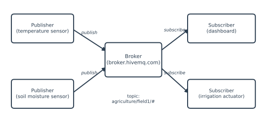
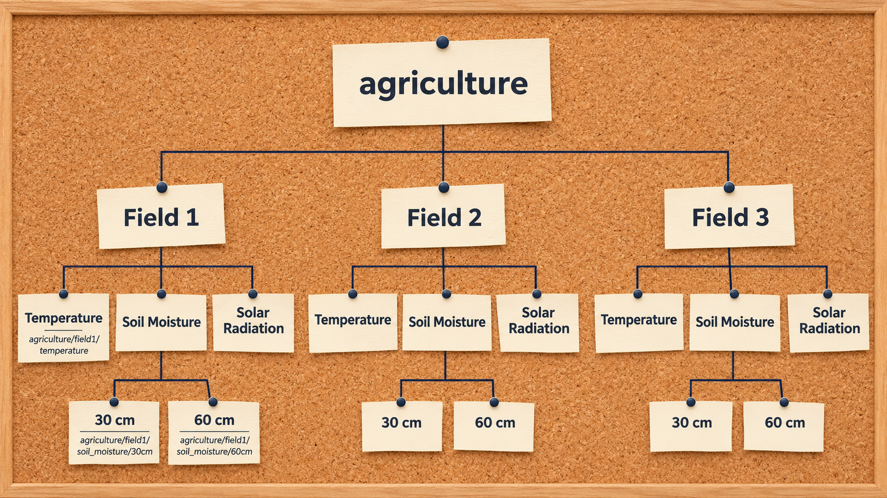




## Intro

MQTT (Message Queuing Telemetry Transport) is a lightweight publish/subscribe messaging protocol built for low-power devices like the ESP32. We'll use it to move sensor and control data between our boards and the cloud.

## Fundamental Concepts

- **Broker:** central hub that routes messages between clients. For class, we use the [Hivemq free public broker](https://www.hivemq.com/public-mqtt-broker/).
- **Client:** anything that connects to the broker — a sensor, an actuator, or a dashboard. A client can publish, subscribe, or both. For testing, use the [Hivemq online client](https://www.hivemq.com/demos/websocket-client/).
- **Topic:** a hierarchical string label for a message (e.g. `agriculture/field1/soil_moisture`).
- **Publish / Subscribe:** a client *publishes* a message to a topic; the broker forwards it to every client that *subscribed* to that topic. Publishers and subscribers never talk to each other directly.



## A bit more about topics

Think of the broker as a bulletin board. A topic is just the path to a spot on that board — levels separated by `/`, from general to specific. A publisher pins a note at a precise spot (e.g. `agriculture/field2/soil_moisture/30cm`); a subscriber reads whichever spot, or group of spots, it cares about.

Here's that bulletin board for three fields, each tracking temperature, solar radiation, and soil moisture at two depths:



A subscriber can read as narrow or as wide a slice of this board as it needs:

* Just field 2's temperature: `agriculture/field2/temperature`
* Soil moisture at 30 cm, in every field: `agriculture/+/soil_moisture/30cm` — the `+` wildcard matches exactly one level, here standing in for the field.
* Everything measured in field 1: `agriculture/field1/#` — the `#` wildcard matches any number of remaining levels, so it catches both soil-moisture depths too.
* Every soil-moisture reading, any field, any depth: `agriculture/+/soil_moisture/#`
* The entire board: `agriculture/#`

```{=html}
<link rel="stylesheet" href="../assets/teaching-demos.css">
<link rel="stylesheet" href="../assets/pulse-mqtt-demos.css">
<script src="../assets/pulse-mqtt-demos.js" defer></script>
```



## Let's try it ourselves

I'll suggest a few ideas, students will divide themselves in groups of 2, and they can choose what mini project to build:

- Upon a button press (digital read), one student's ESP32 publishes via MQTT a command to "open" or "close"; the other ESP32 subscribes to that topic, and depending on what's written, opens or closes a relay that powers an LED.
- One ESP32 measures temperature and humidity with an SHT31 and publishes the readings every 5 seconds; the other ESP32 subscribes and shows the measurements on an OLED screen.
- One ESP32 reads a potentiometer and publishes a 0–255 brightness value; the other subscribes and uses it to dim the built-in RGB LED.
- One ESP32 reads a light sensor (photoresistor) and publishes "day" or "night" whenever the light level crosses a threshold; the other subscribes and switches a relay — e.g. a grow light — accordingly.
- One ESP32 counts pulses with the pulse sensor and publishes the running count every few seconds; the other subscribes and displays the total on an OLED screen.
- One ESP32 reads a touch pin as a doorbell button and publishes a "ring" message; the other subscribes and flashes its RGB LED whenever a ring arrives.

## LED subscribe

The ESP32 subscribes to a topic and turns an LED on pin A4 on or off based on the `1`/`0` it receives.

```{python}
#| echo: false
#| output: asis
code_source("MQTT_led_subscribe.ino")
```

## Publish text

The ESP32 publishes a fixed text message to a topic every 5 seconds.

```{python}
#| echo: false
#| output: asis
code_source("agrotech_mqtt_publish_text.ino")
```

## Sensor subscribe

The ESP32 subscribes to a topic and prints each incoming reading to the Serial monitor as a float.

```{python}
#| echo: false
#| output: asis
code_source("MQTT_sensor_subscribe.ino")
```


## Publish and subscribe

The ESP32 publishes a random "temperature" reading and a text message once per second, while also subscribing to and printing any message sent back to it.

```{python}
#| echo: false
#| output: asis
code_source("MQTT_publish_and_subscribe.ino")
```

## MQTT + Python

## Subscribe

A Python script subscribes to all sub-topics under `agrotech/mqtt_tutorial/` and prints every message it receives.

```{python}
#| echo: false
#| output: asis
code_source("MQTT_python_subscribe.py")
```

## Publish

A Python script publishes a slowly drifting simulated temperature value once per second.

```{python}
#| echo: false
#| output: asis
code_source("MQTT_python_publish.py")
```

## Subscribe to CSV

A Python script subscribes to all incoming sensor topics and saves every message, with a timestamp, to a CSV file.

```{python}
#| echo: false
#| output: asis
code_source("mqtt_to_csv.py")
```


## Control irrigation solenoid in the greenhouse

Use the code below to control the irrigation solenoid outside the greenhouse.

Code usage: connect a jumper to A4. Whenever you touch the jumper, the solenoid will be open, otherwise it will be closed.

The ESP32 publishes `1` or `0` to a topic based on whether pin A4 is touched, toggling the greenhouse's irrigation solenoid through Home Assistant.

```{python}
#| echo: false
#| output: asis
code_source("mqtt_toggle_irrigation.ino")
```

