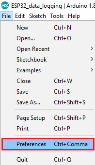
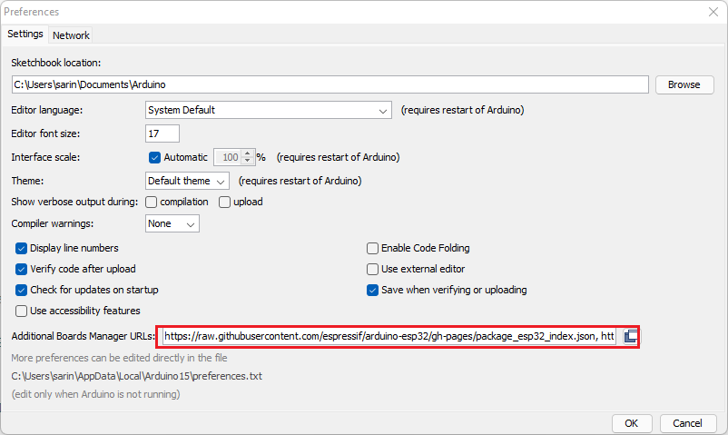
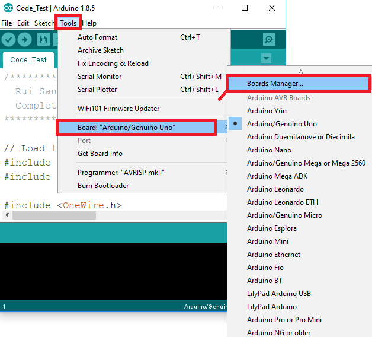
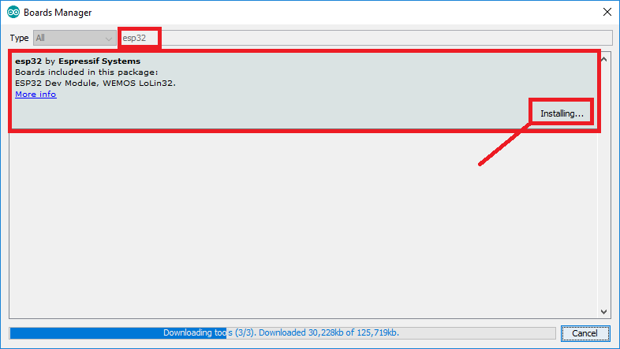
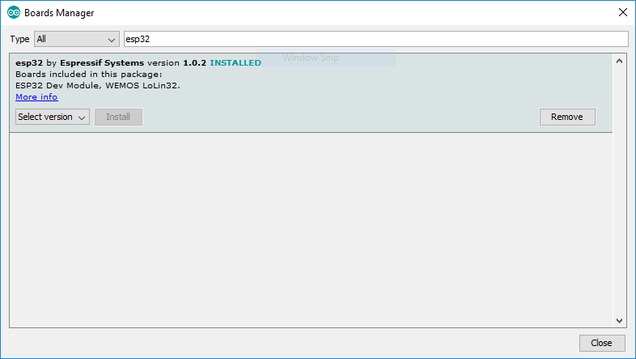
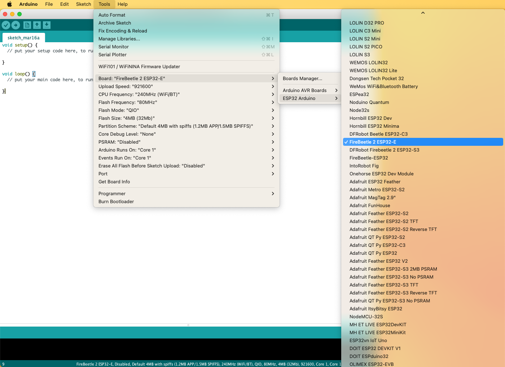

## Arduino IDE

Arduino IDE is the free application we'll use to write code and upload it to the FireBeetle board. Go to the official [Arduino website](https://www.arduino.cc/en/software), download the installer for your operating system, and run it.

## Install the FireBeetle 2 (ESP32) board

We will be using the [FireBeetle 2 ESP32-E IoT Microcontroller](https://www.dfrobot.com/product-2195.html) as our main MCU. Full documentation of this MCU can be found on the [product wiki](https://wiki.dfrobot.com/FireBeetle_Board_ESP32_E_SKU_DFR0654) by DFRobot. For a quick pinout reference, take a look at [this page](/posts/tutorials/firebeetle_documentation.html).

Follow these steps to add FireBeetle/ESP32 support to the Arduino IDE:

1. Add the board URL in the IDE preferences.
2. Install the ESP32 board core via the Boards Manager.
3. Select the board and serial port.

### Add URL to Arduino IDE

In your Arduino IDE, go to `File > Preferences`

Enter the following into the "Additional Board Manager URLs" field:

`https://raw.githubusercontent.com/espressif/arduino-esp32/gh-pages/package_esp32_index.json`

Then, click the "OK" button:

**Note: if you already have a different URL, you can separate the URLs with a comma as follows:**

`http://download.dfrobot.top/FireBeetle/package_DFRobot_index.json, https://raw.githubusercontent.com/espressif/arduino-esp32/gh-pages/package_esp32_index.json`

Open the Boards Manager. Go to `Tools > Board > Boards Manager`

Search for ESP32 and press the install button for "ESP32 by Espressif Systems".

That's it. The installation can take a few minutes. Take a break.

### Select board and port

Once the board is installed, select it:
Open `Tools->Board->ESP32 Arduino->FireBeetle 2 ESP32-E`

Then select the Port
Open `Tools->Port->COMxx` (for windows the port wil be `COM` with some number, for Mac/linux it will be `/dev/cu.` and then something).
How do you know what port to choose?
Check the ports without the MCU pluged into the computer. Then plug the MCU and check the ports again. If you see a new port, thats the port of the MCU.

## Troubleshooting

Troubleshooting if there is no port for the MCU:

 1. Missing driver. Could be you need to install a specific driver.
 [Windows driver](https://dfimg.dfrobot.com/nobody/wiki/0e0d6b3864f7163833ec5d7ad4af7632.EXE)
 [MacOS driver](https://dfimg.dfrobot.com/nobody/wiki/c195a13df2a1989d5dc04e76e6bcb701.ZIP)
 2. Bad USB cable. Some cables are bad and some are only for charging and cannot sync data. Try using a different USB cable that worked for a freind.

::: {.callout-tip}
## Ready for a larger project?
Try the optional [VS Code + PlatformIO tutorial](platformio-vscode.qmd): project folders, build and upload, libraries, and Codex or Claude Code inside the editor. It uses the same FireBeetle board and Arduino programming functions.
:::
