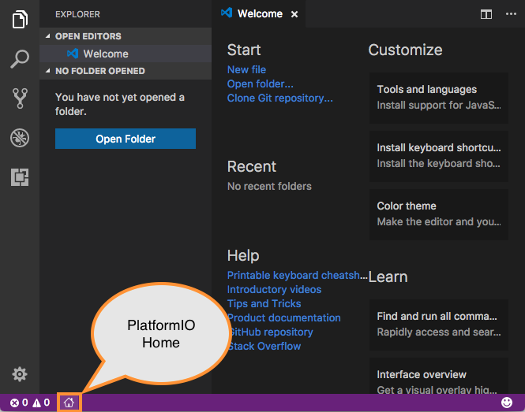
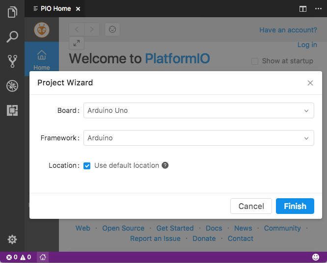

# VS Code + PlatformIO {.unnumbered}

An optional workflow for students who want to take their projects further. We will use the **FireBeetle 2 ESP32-E**, keep programming with Arduino functions, and put the code, board settings, libraries, and an optional AI assistant in one workspace.

By the end, you will have a blinking LED, messages in the Serial Monitor, and a project you can share with a teammate. Start with steps 1–5; the later sections help you move an existing sketch and work on larger projects.

**Checked: October 19, 2026.** Menus may move as the extensions change. The links throughout this guide go to the official documentation.

## What changes from Arduino IDE? {#what-changes}

You are changing the tools on your computer. The board still runs your program, and `setup()`, `loop()`, `digitalWrite()`, and the other Arduino functions still work when you select the **Arduino framework**.

| In your usual Arduino workflow | In this tutorial |
|---|---|
| Open a sketch, usually an `.ino` file | Open a whole project folder; edit `src/main.cpp` |
| Select the board through a menu | Save the board and framework in `platformio.ini` |
| Install libraries with Library Manager | List project libraries under `lib_deps` |
| Verify, Upload, Serial Monitor | Build, Upload, Monitor |
| Share a sketch and explain its settings | Share code and configuration together |

Arduino IDE remains a convenient way to start. Modern Arduino IDE also has features such as code completion; the reason to try this workflow is the project organization, repeatable settings, and editor tools. See [Arduino's IDE guide](https://docs.arduino.cc/software/ide-v2/tutorials/getting-started-ide-v2/).

There are three pieces to understand:

- **VS Code** is the editor: files, search, terminal, Git, and extensions.
- **PlatformIO** manages the board tools, libraries, compilation, and upload.
- **Arduino** is the framework used by our program. PlatformIO can use other frameworks, but we will stay with Arduino here.

You do not need to install Arduino IDE first. PlatformIO downloads its own tools; changing a board package in Arduino IDE does not change this project's PlatformIO package. [PlatformIO's Arduino framework documentation](https://docs.platformio.org/en/latest/frameworks/arduino.html) explains this setup.

## 1. Install the tools {#install-tools}

Have the FireBeetle and a **USB data cable** ready. For this first setup, use VS Code on the computer connected to the board.

1. Install the desktop version of [Visual Studio Code](https://code.visualstudio.com/download) for Windows, macOS, or Linux. This is a different application from Visual Studio.
2. Open **Extensions**: `Ctrl+Shift+X` on Windows/Linux or `Cmd+Shift+X` on macOS.
3. Search for **PlatformIO IDE**, published by **PlatformIO**, and install it. Its extension ID is `platformio.platformio-ide`.
4. Let the initial setup finish, then reload VS Code if asked. Open **PlatformIO Home** using its home icon, or find **PlatformIO: Home** in the Command Palette (`Ctrl+Shift+P` / `Cmd+Shift+P`).

The extension includes PlatformIO Core, so a separate `pip install platformio` is unnecessary. Linux may need `python3-venv`; follow the OS-specific requirements in the [official installation instructions](https://docs.platformio.org/en/latest/integration/ide/vscode.html#installation). Install [Git](https://git-scm.com/downloads) when you want to clone or version your project.

{fig-alt="Official VS Code screenshot with an arrow pointing to the PlatformIO Home icon in the bottom status bar." width=665}

## 2. Create a FireBeetle project {#create-project}

In **PlatformIO Home → New Project**, enter:

| Field | Choose |
|---|---|
| Name | `firebeetle-first-project` |
| Board | **DFRobot Firebeetle 2 ESP32-E** |
| Framework | **Arduino** |
| Location | A local folder where you keep your projects |

Click **Finish** and allow the downloads to complete. In VS Code's Explorer, you should now see `platformio.ini` and a `src` folder. If you reopen the project later, use **File → Open Folder** and select the folder containing `platformio.ini`.

{fig-alt="PlatformIO Project Wizard showing Board, Framework and Location fields, with a Finish button. The pictured board is Arduino Uno; this guide uses FireBeetle 2 ESP32-E." width=666}

The board's exact identifier is `dfrobot_firebeetle2_esp32e`. Check the [official board page](https://docs.platformio.org/en/latest/boards/espressif32/dfrobot_firebeetle2_esp32e.html) if the names in the menu are confusing. Other FireBeetle models need their own board configuration.

::: {.callout-tip}
## Prefer to start from the finished files?
[Download the starter project](../assets/downloads/firebeetle-platformio-starter.zip). Extract it, open the extracted folder containing `platformio.ini` in VS Code, and continue with step 3. The ZIP contains the configuration and blink program shown below.
:::

## 3. Read the project settings {#project-settings}

Replace the contents of **`platformio.ini`** with:

```ini
[env:firebeetle]
platform = platformio/espressif32@8.0.0
board = dfrobot_firebeetle2_esp32e
framework = arduino
monitor_speed = 115200
```

Save the file. PlatformIO may download packages or refresh its project information.

| Line | What it means |
|---|---|
| `[env:firebeetle]` | A named set of settings. We call this environment `firebeetle`. |
| `platform` | The ESP32 support package and its tools. `@8.0.0` selects a specific release. |
| `board` | The actual board we are building for. |
| `framework` | Use the Arduino programming framework. |
| `monitor_speed` | Open the serial connection at 115200 baud; the code must use the same rate. |

An *environment* here means a build configuration, not a Python virtual environment. Later, a project can have several environments for different boards or settings. For now, keep just this one. See the [configuration reference](https://docs.platformio.org/en/latest/projectconf/index.html) and [platform version option](https://docs.platformio.org/en/latest/projectconf/sections/env/options/platform/platform.html).

::: {.callout-note}
## Platform version and Arduino version are different
PlatformIO's **Espressif32 8.0.0** release uses **Arduino-ESP32 3.3.12**. The two numbers describe different packages. We pin the platform so a teammate can start with the same release. This is the version used for this guide, not a promise that it will always be the newest. [Release notes](https://github.com/platformio/platform-espressif32/releases/tag/v8.0.0).

Some older course sketches use Arduino-ESP32 2.x functions. For example, 3.x replaced `ledcSetup()` and `ledcAttachPin()` with a different LEDC API. A compile error in an older PWM sketch may be a framework-version issue. Check [Espressif's migration guide](https://docs.espressif.com/projects/arduino-esp32/en/latest/migration_guides/2.x_to_3.0.html) before changing the code or package version.
:::

## 4. Write and build your first program {#first-program}

Open **`src/main.cpp`** and replace its contents with:

```cpp
#include <Arduino.h>

const unsigned long BLINK_TIME_MS = 500;

void setup() {
  pinMode(LED_BUILTIN, OUTPUT);
  Serial.begin(115200);
}

void loop() {
  digitalWrite(LED_BUILTIN, HIGH);
  Serial.println("LED ON");
  delay(BLINK_TIME_MS);

  digitalWrite(LED_BUILTIN, LOW);
  Serial.println("LED OFF");
  delay(BLINK_TIME_MS);
}
```

`#include <Arduino.h>` makes the Arduino functions available in this C++ file. `LED_BUILTIN` uses the board definition's LED pin; for this FireBeetle variant it is GPIO 2. [Espressif's board definition](https://github.com/espressif/arduino-esp32/blob/3.3.12/variants/dfrobot_firebeetle2_esp32e/pins_arduino.h).

Save, then click the PlatformIO **Build** checkmark in the bottom toolbar. You can also open the PlatformIO icon on the left and choose **Project Tasks → firebeetle → General → Build**. Look for **SUCCESS** in the terminal output. The first build takes longer because tools and framework files may need to be downloaded.

**Build only prepares the program on your computer.** You can do this with the board unplugged. To run the program on the FireBeetle, upload it next.

## 5. Upload and read the messages {#upload-monitor}

1. Connect the FireBeetle with the USB data cable.
2. Close any Arduino IDE Serial Monitor using that board.
3. Select **Upload** in the same PlatformIO project tasks, or use the right-arrow icon in its toolbar. Wait for a successful upload.
4. Select **Monitor**, or the plug-shaped serial-monitor icon. Confirm it opens at **115200**.
5. You should see alternating messages, and the onboard LED should turn on and off every half second:

```text
LED ON
LED OFF
LED ON
LED OFF
```

Try changing `BLINK_TIME_MS` to `1000`, save, and upload again. The LED should now spend one second on and one second off. Editing or building alone does not update the program already on the board.

### If PlatformIO chooses the wrong port

Open the **PlatformIO Core CLI** terminal from PlatformIO's **Quick Access → Miscellaneous** and run:

```sh
pio device list
```

Compare the list with the board unplugged and plugged in. Windows ports look like `COM7`; macOS often uses `/dev/cu.usbserial-...`; Linux often uses `/dev/ttyUSB0`. Your actual port may differ.

If necessary, add both lines below **inside the existing `[env:firebeetle]` section**, replacing `COM7` with your board's port:

```ini
upload_port = COM7
monitor_port = COM7
```

Leave these out when automatic detection works. A teammate's port will probably differ from yours. See [upload options](https://docs.platformio.org/en/latest/core/userguide/cmd_run.html) and the [serial monitor reference](https://docs.platformio.org/en/latest/core/userguide/device/cmd_monitor.html). In the terminal monitor, `Ctrl+C` exits and releases the port.

### The same workflow from a terminal

In the **PlatformIO Core CLI** terminal, with the project folder as the current directory:

| Command | Action |
|---|---|
| `pio run -e firebeetle` | Build this environment |
| `pio run -e firebeetle -t upload` | Build and upload |
| `pio device monitor -b 115200` | Read serial messages |
| `pio run -e firebeetle -t clean` | Remove generated build files before rebuilding |

If a normal terminal says `pio` is not found, open PlatformIO's own terminal. That message usually concerns the terminal's command path, not your Arduino code. These commands also give an AI assistant a clear way to check a build.

## 6. Know what belongs in each folder {#project-folders}

This is a typical project after its first build. Some folders are created by the wizard or only appear when you need them; the starter ZIP deliberately contains just the essentials.

```text
firebeetle-first-project/
├── platformio.ini       Board, framework, versions, libraries
├── src/
│   └── main.cpp         Your program
├── include/             Your shared .h header files
├── lib/                 Libraries you write for this project
├── test/                Automated tests, when you add them
├── .pio/                Generated builds and downloaded libraries
├── .vscode/             Editor configuration
├── .gitignore           Files Git should leave out
└── README.txt           How to wire, build, and run the project
```

Start by editing `src/main.cpp` and `platformio.ini`. As the code grows, move related functions into additional `.cpp` files under `src/` and put their declarations in `.h` files under `include/`.

Treat `.pio/` as generated output. Do not edit libraries inside it: your changes can disappear when dependencies are reinstalled. Use `lib/` for your own project libraries and `lib_deps` for published dependencies. The [directory reference](https://docs.platformio.org/en/latest/projectconf/sections/platformio/options/directory/index.html) describes these defaults.

For GitHub, include your source, `platformio.ini`, `.gitignore`, and a short README with the wiring and instructions. Keep `.pio/` out. The starter also ignores `.vscode/`; you can later choose to share useful editor settings. If you add a local file such as `include/secrets.h` for Wi-Fi passwords or service keys, keep it out of Git and share a placeholder example instead.

## 7. Bring an Arduino sketch and its libraries {#move-a-sketch}

### Move the code

Create the PlatformIO project first, then:

1. Copy the sketch into `src/main.cpp`.
2. Add `#include <Arduino.h>` at the top.
3. Keep one `setup()` and one `loop()` in the project.
4. Declare your own functions before calling them, or place their full definitions above the call.

Arduino's `.ino` processing often adds declarations for you. A `.cpp` file expects you to provide them. For example:

```cpp
#include <Arduino.h>

void printReading();  // Declare it before setup() calls it.

void setup() {
  Serial.begin(115200);
  printReading();
}

void loop() {
}

void printReading() {
  Serial.println("Ready to read a sensor");
}
```

When moving several Arduino tabs, check all function declarations and shared variables. Do not leave a second copy of the old program in `src/`: PlatformIO also compiles other source files there, which can cause duplicate `setup()` or `loop()` errors. See [PlatformIO's `.ino` to `.cpp` guide](https://docs.platformio.org/en/latest/faq/ino-to-cpp.html).

### Add a library to this project

For example, a later MQTT program might use PubSubClient. Open **PlatformIO Home → Libraries**, find **PubSubClient** by **knolleary**, and use its installation information. Add this to your existing environment in `platformio.ini`:

```ini
lib_deps =
  knolleary/PubSubClient@2.8
```

Then include it in the program that needs it:

```cpp
#include <PubSubClient.h>
```

Save and build. PlatformIO installs the declared dependency for that project. Version `2.8` is an explicit example, not a claim that it is the latest release. Record the versions you test so teammates use the same ones. Libraries installed in Arduino IDE's Library Manager are not automatically this project's dependencies. [Library dependency reference](https://docs.platformio.org/en/latest/projectconf/sections/env/options/library/lib_deps.html).

The blink starter needs no `lib_deps`. Common ESP32 Arduino components such as `WiFi.h` and `Wire.h` come with the framework; do not install an unrelated similarly named library to fix an include error.

## 8. Add Codex or Claude Code {#ai-assistant}

Once your first build and upload work, I recommend trying **one** AI coding extension. Keeping the assistant beside the project lets you ask about actual files, review changes, and use the build output in the same place. Both options below can help; choose the one you already have access to. AI access and usage limits depend on your account, and neither is required for PlatformIO.

### Option A: Codex by OpenAI

1. In Extensions, find **Codex** published by **OpenAI** (`openai.chatgpt`), using the install link in the [official Codex IDE guide](https://developers.openai.com/codex/ide/).
2. Open the Codex icon. If it is hidden, use the Command Palette and **Codex: Open Codex Sidebar**.
3. Choose **Sign in with ChatGPT** and finish the browser sign-in. An API-key option also exists, with separate usage-based billing. See [OpenAI's authentication guide](https://developers.openai.com/codex/auth/).
4. Keep the FireBeetle project folder open. Open `platformio.ini` and `src/main.cpp`, then ask Codex to explain this project before requesting a change.

Use the local project workflow while working with the USB board. Review the changed lines in the editor and build again after accepting an edit.

### Option B: Claude Code by Anthropic

1. Install **Claude Code** published by **Anthropic** (`anthropic.claude-code`) from Extensions.
2. Open a source file, then click the Claude spark icon or find Claude Code in the Command Palette.
3. Follow the sign-in prompt. The documented options include a paid Claude subscription or a Claude Console account; check your account's access and billing.
4. Reference `platformio.ini` and `src/main.cpp` with `@` in the conversation, and start with the same explanation request below.

The extension includes the CLI it needs for its chat panel. A separate standalone CLI installation is only needed if you want to run the `claude` command in a terminal. Follow the [official VS Code instructions](https://code.claude.com/docs/en/vs-code); on Windows, also check the [current Windows prerequisites](https://code.claude.com/docs/en/setup#set-up-on-windows).

### A useful first conversation

Copy this into either assistant:

```text
Read platformio.ini and src/main.cpp. Explain what runs on the computer
and what runs on the FireBeetle 2 ESP32-E. Explain each project setting
and what the LED program does. Do not change any files yet.
```

Then try one small change:

```text
Replace the delay-based blinking with millis() timing, keeping the same
LED pin and the same 500 ms on / 500 ms off behavior. Print a message only
when the LED changes. Keep the board, framework, and package versions.
Explain the change, then build with pio run -e firebeetle and report the
result. Do not upload; I will test it on the board.
```

If the assistant cannot find `pio`, run the build in the PlatformIO Core CLI yourself and give it the first meaningful error and surrounding lines. A build result is more useful than the final line saying “failed.”

Review what changed, upload, and check the LED and messages. Compiling verifies that the code can be built; it does not verify your wiring or prove that a sensor reading is correct. Keep a working Git commit before a larger edit, and leave real passwords and API keys out of prompts and shared files.

For a sensor project, include the exact sensor model, connected GPIO numbers, expected units, and actual error. For example: “My SHT31 uses SDA 21, SCL 22, address 0x44. Explain why this program gets no reading.” The assistant should work from your wiring, not invent it.

## When something does not work {#troubleshooting}

| What you see | What to check first |
|---|---|
| No PlatformIO tasks | Open the folder containing `platformio.ini`; wait for extension setup. Check the extension is enabled. |
| `Arduino.h` has a red underline | Run Build. If it succeeds, try **PlatformIO: Rebuild IntelliSense Index** from the Command Palette. An editor underline and a compiler error are different things. |
| `...h: No such file or directory` | Check the header spelling and the dependency's official installation instructions. Add the right library to this environment. |
| `was not declared in this scope` | For your own function, check its declaration. For an ESP32 API, check the framework version. |
| `multiple definition of setup` or `loop` | Keep only one program entry point; move spare sketches out of `src/`. |
| No USB port appears | Try a known data cable and another USB port. Check the board manufacturer's USB driver instructions. |
| Port busy / access denied | Close other serial monitors. On Linux, check serial-device permissions. |
| Upload cannot connect | Confirm the selected port and board, reconnect USB, and check the manufacturer's upload troubleshooting. |
| Unreadable serial text | Match `Serial.begin(115200)` and `monitor_speed = 115200`. |
| Build succeeds, old behavior remains | Save and Upload; Build alone leaves the old firmware running. |

Board-specific help: [DFRobot's FireBeetle 2 ESP32-E wiki](https://wiki.dfrobot.com/FireBeetle_Board_ESP32_E_SKU_DFR0654). Linux permissions: [PlatformIO's udev guide](https://docs.platformio.org/en/latest/core/installation/udev-rules.html).

**What about breakpoints?** USB upload and serial messages work with this setup. The FireBeetle 2 ESP32-E has no onboard debug probe, so stepping through firmware at breakpoints needs additional supported debug hardware and configuration. Start by printing values to the serial monitor. See the board's [debugging section](https://docs.platformio.org/en/latest/boards/espressif32/dfrobot_firebeetle2_esp32e.html#debugging).

## Try it on your next project {#next-project}

Move one familiar sketch into this structure. Get it building first, then upload and compare its behavior with the Arduino IDE version. Add one library or one feature at a time. Your README should let another student identify the board, connect the sensor, build the program, and understand the serial output.

The two screenshots above are reproduced unchanged from the [PlatformIO documentation](https://docs.platformio.org/en/latest/integration/ide/vscode.html), under its [Apache 2.0 license](../assets/platformio-guide/LICENSE.txt). They illustrate the interface; their pictured boards and older styling are not the configuration used by this guide.

*Validation for this edition: the starter and the function-declaration example with PubSubClient 2.8 compiled successfully on macOS with PlatformIO Core 6.2.0 and the configuration above. USB upload, LED behavior, and serial output still need to be checked on your physical board.*
