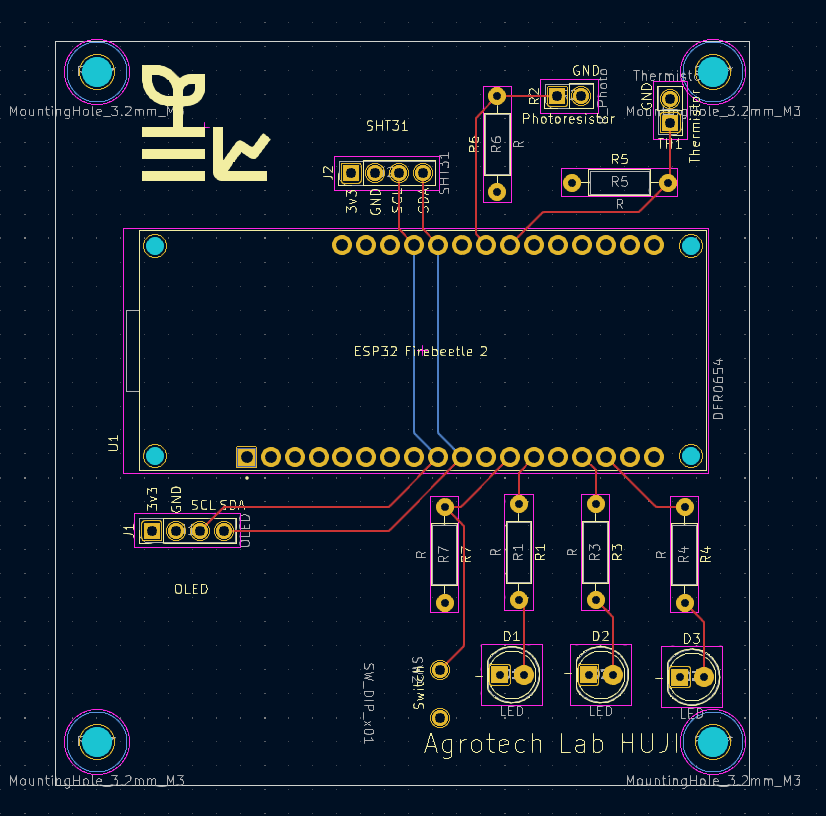
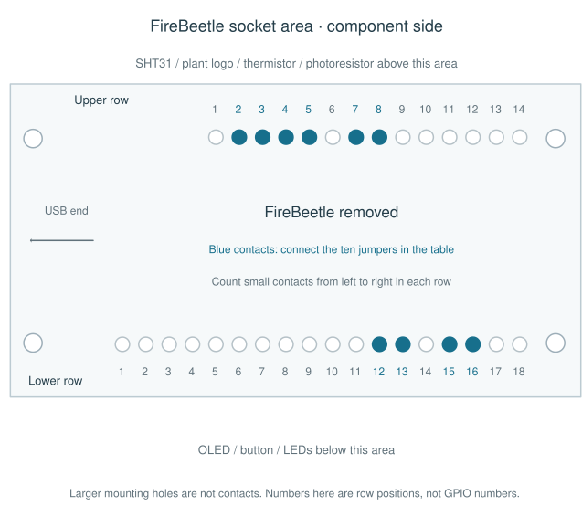

Breadbord is fun and easy but sooner or later everyone working with Arduino will need to know how to solder and work with wires. 
There are amazing tutorials that allready exist. Even though we will learn many of the topics in class, we strongly recomend to take a look at these tutorials.  

* [Soldering - by Sparkfun](https://learn.sparkfun.com/tutorials/how-to-solder-through-hole-soldering/all)
* [Soldering - by Adafruit](https://learn.adafruit.com/adafruit-guide-excellent-soldering) (note that this is a multi page guide)
* [Working with wire - by Sparkfun](https://learn.sparkfun.com/tutorials/working-with-wire)

## Our class PCB {#class-pcb}

We will assemble the Agrotech Lab soldering board in class. Use the supplied parts kit and check component orientation with the instructor before soldering. Some labels in the design are generic (for example, `R` and `LED`); the manufacturing BOM does not specify all component values.

{fig-alt="Agrotech Lab PCB layout showing the FireBeetle footprint, SHT31 and OLED headers, resistors, LEDs and mounting holes."}

[Open the schematic PDF](../archive/hardware/soldering-board-1/Schematic.pdf) · [Download the editable KiCad project](../archive/hardware/soldering-board-1/soldering-board-project.zip)

After soldering, let the board cool, inspect for bridges and trim the leads before mounting it. Our [3D-printing lesson](3d-printing.qmd) includes a rotating board reference and a printable stand based on these exact mounting holes. Solder on a heat-resistant work surface; fit the plastic stand afterwards.

### The board in 3D {#pcb-in-3d}



[Download the assembly model for viewing (.glb)](../archive/3d-printing/pcb-assembly.glb?v=sht31-purple-1) · [Build the open stand step by step](3d-printing.qmd#worked-example)

## Using an Arduino Nano ESP32 {#nano-esp32}

You can use the same class PCB with an **Arduino Nano ESP32**. Put the Nano on a breadboard beside the PCB and run ten jumper wires to the empty FireBeetle connections. The sensors, button and LEDs stay on the class PCB.

::: {.callout-important title="Use the Nano ESP32 and 3.3 V"}
This wiring is for the **Arduino Nano ESP32**, not the classic 5 V Arduino Nano. Power the Nano through USB-C and connect its **3V3** output to the PCB's **3V3** connection, with a shared **GND**. Keep VUSB/VBUS, VIN and 5 V away from the PCB's 3V3 and signal connections. The Nano ESP32 uses 3.3 V signals; see the [Arduino power specifications](https://docs.arduino.cc/resources/datasheets/ABX00083-datasheet.pdf).
:::

### Set up the boards

1. **Unplug power and remove the FireBeetle.** The Nano has a different pin layout: do not plug it into the FireBeetle sockets. Leave the FireBeetle disconnected throughout this setup.
2. **Place the Nano across the breadboard's centre gap**, with its two rows of pins on opposite sides. Each Nano pin goes into a separate connected strip of five breadboard holes. Leave the USB connector accessible. If your Nano has no headers, solder male headers onto it first.
3. **Choose the jumper ends that fit your PCB.** For female sockets on the PCB, use male-to-male jumper wires. For male pins on the PCB, use male-to-female jumpers, with the female end on the PCB. The breadboard end is male in either case. Empty, unsoldered PCB holes need soldered headers before you can use push-in jumpers reliably.
4. **Run each jumper from a free hole in the Nano pin's connected strip to the PCB contact in the table.** Keep the wires short enough to follow easily; red for 3V3 and black for GND help. The PCB already contains the sensor divider resistors and LED resistors, so you do not need to duplicate those circuits on the breadboard.

If the breadboard connections are unfamiliar, try the [breadboard explorer](breadboard.qmd) first.

### Find the right PCB contacts

Look at the **component side**, with the plant logo and SHT31 at the top, and the OLED, button and LEDs at the bottom. The FireBeetle's USB end would point left. The upper FireBeetle row has **14 small contacts**; the lower row has **18**. Count from the left separately in each row, skipping the larger mounting holes. These row positions are only a way to find the holes; they are not GPIO numbers.

{fig-alt="Component-side socket locator. Upper row: 14 contacts numbered left to right, with 2, 3, 4, 5, 7 and 8 selected. Lower row: 18 contacts, with 12, 13, 15 and 16 selected. The USB end is left, SHT31 above, OLED and button below."}

[Open the socket diagram at full size](../archive/figures/diagrams/nano-esp32-pcb-sockets.svg).

Follow the **labels printed on the Nano**, using the [official Nano ESP32 pinout](https://docs.arduino.cc/resources/pinouts/ABX00083-full-pinout.pdf) to locate them. The PCB destinations below were traced through our KiCad design.

::: {.table-responsive role="region" aria-label="Nano ESP32 jumper wiring" tabindex="0"}

| Nano ESP32 pin | PCB connection | PCB socket position | What it connects |
|:--|:--|:--|:--|
| **3V3** | 3V3 | Upper row, **2nd** contact | Power for the PCB |
| **GND** | GND | Upper row, **3rd** contact | Shared ground |
| **A5 / SCL** | SCL | Upper row, **4th** contact | Clock for OLED and SHT31 |
| **A4 / SDA** | SDA | Upper row, **5th** contact | Data for OLED and SHT31 |
| **A3** | A3 | Upper row, **7th** contact | Photoresistor (R2) |
| **A2** | A2 | Upper row, **8th** contact | Thermistor (TH1) |
| **D7** | D7 | Lower row, **12th** contact | Pushbutton (SW2) |
| **D6** | D6 | Lower row, **13th** contact | First LED (D1 on the PCB) |
| **D3** | D3 | Lower row, **15th** contact | Second LED (D2 on the PCB) |
| **D2** | D2 | Lower row, **16th** contact | Third LED (D3 on the PCB) |

:::

The OLED and SHT31 share the PCB's I²C bus: **one SDA wire and one SCL wire serve both modules**. Leave all other FireBeetle contacts unconnected. Check the row positions and 3V3/GND connections before plugging the Nano's USB cable in.

### Use the Nano pin names in your code

In Arduino IDE, install [**Arduino ESP32 Boards** by Arduino](https://docs.arduino.cc/tutorials/nano-esp32/getting-started-nano-esp32/) from Boards Manager, then select **Arduino Nano ESP32** as your board. In Arduino IDE, use **Tools → Pin Numbering → By Arduino pin (default)**. Write pin labels such as `D6`, `D7`, `A2` and `A3` in your sketch instead of copying bare ESP32 GPIO numbers from a FireBeetle example. The labels also work if the Nano's pin-numbering setting changes; [Arduino explains the two numbering options here](https://support.arduino.cc/hc/en-us/articles/10483225565980-Select-pin-numbering-for-Nano-ESP32-in-Arduino-IDE).

```cpp
const int THERMISTOR_PIN = A2;
const int LIGHT_PIN = A3;
const int BUTTON_PIN = D7;
const int LED_PINS[] = {D6, D3, D2};  // PCB LEDs D1, D2, D3

// Use these definitions in the complete check sketch linked below.
```

For I²C, include `<Wire.h>` and call `Wire.begin()` inside `setup()`. With the Nano ESP32 board selected, this uses **SDA = A4** and **SCL = A5**.

**Adapt older examples to this wiring.** On this PCB the thermistor is on **A2** and the photoresistor is on **A3**, even if a standalone lesson uses A4. Here A4 is already SDA. Replace explicit FireBeetle I²C GPIO choices with `Wire.begin()` when using this Nano setup. A PCB label like “D1” beside an LED is the component's name; it does not mean Nano pin D1.

### Check the connections

[Download the complete Nano ESP32 PCB check sketch](../archive/code/nano_esp32_class_pcb.ino). Open it in Arduino IDE, select your Nano ESP32 and port, upload, then open **Serial Monitor at 115200 baud**. It uses only the built-in Arduino and Wire libraries.

- **Press and release the button:** all three PCB LEDs should turn on while it is pressed and off when released. A pressed button reads `LOW` because it connects D7 to ground.
- **Cover and uncover the photoresistor:** the `Light A3` reading should change. Gently warm the thermistor between your fingers and watch `Thermistor A2` change. These are raw 12-bit readings (0–4095), not lux or degrees; temperature conversion needs the actual thermistor and resistor values.
- **Watch the I²C scan every five seconds:** with both modules installed and powered, expect two responding addresses. This check finds the OLED and SHT31 on the bus; it does not draw on the screen or read temperature yet. If none appear, check the shared power, ground, SDA and SCL wiring. If only one appears, check the other module's solder joints and pin order.

Once these checks work, use the [OLED lesson](OLED.qmd) and [digital-sensor lesson](digital-sensors.qmd), keeping the Nano pin choices above.
